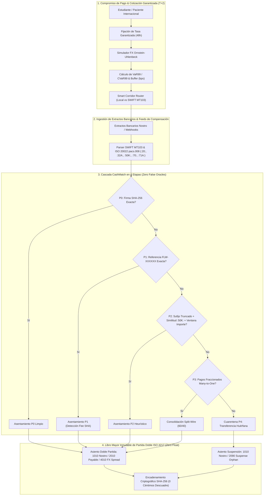

# `crossborder-fx-reconciliation`: Cross-Border FX Risk, Smart Routing & Double-Entry CashMatch Engine

> **Librería / PoC de Dominio:** Reconciliación bancaria multidivisa y ledger inmutable contra retenciones bancarias (Inspirado en los flujos de *Flywire*)  
> **Autor:** Juan Diego Ussa Aponte (Valencia, España)  
> **Aplicación Sectorial:** Fintech de pagos B2B internacionales, pasarelas de pago para universidades y travel tech  
> **Filosofía:** *Zero Placeholders* • *Zero IEEE-754 Float in Ledger* • *SHA-256 Hash-Chained Accounting*

---

## 1. Problema de Negocio Real en Flywire

Flywire procesa más de **24.000M$ anuales** en pagos transfronterizos para universidades, hospitales y empresas en más de 140 divisas. En su operativa diaria desde el hub de ingeniería y operaciones de Valencia confluyen tres retos críticos:

1. **Integridad Contable Institucional (Tolerancia Cero a Coma Flotante):** Los libros mayores no pueden usar `float` de coma flotante ni mezclar divisas de 2 decimales (`EUR`, `USD`, `GBP`, `CNY`) con divisas de 0 decimales (`JPY`, `KRW`). Cada transferencia conciliada o huérfana debe cuadrar al céntimo en una contabilidad de **Doble Partida** auditable.
2. **Riesgo de Cola Cambiario (`FX Tail Risk`) y Selección de Raíles de Pago:** Cuando un estudiante bloquea un tipo de cambio garantizado durante 48 horas ($T+2$), la volatilidad del mercado de divisas puede erosionar el margen. Además, enrutar por cadenas corresponsales SWIFT tradicionales introduce demoras de 48–72h y deducciones inesperadas (*lifting fees*), frente a usar la red de **Cuentas de Recaudación Local** (*Local Domestic Collection Rails*) de Flywire.
3. **Conciliación SWIFT MT103 / ISO 20022 (`pacs.008`) y Pagos Fraccionados (*Split Wires*):** Los extractos bancarios llegan con el campo `:70:` truncado a 35 caracteres por bancos intermediarios, con comisiones deducidas bajo cláusula `:71A: SHA` ($15–$35), o **fraccionados en múltiples transferencias (*Many-to-One*)** cuando padres en China o India dividen la matrícula en dos envíos (60% + 40%) por límites bancarios diarios.

---

## 2. Diagrama de Arquitectura End-to-End



---

## 3. Arquitectura Modular de la PoC v2.0

| Archivo | Responsabilidad Técnica |
| :--- | :--- |
| [`domain_ledger.py`](./domain_ledger.py) | Objeto de valor inmutable `Money` en unidades menores enteras (`amount_minor: int`) con redondeo bancario `ROUND_HALF_EVEN` y soporte nativo 0-decimales (`JPY`/`KRW`). Máquina de estados estricta (`PaymentCommitment`) y Libro Mayor de Doble Partida (`ImmutableDoubleEntryLedger`) encadenado con hashes criptográficos **SHA-256**. |
| [`sqlite_ledger_storage.py`](./sqlite_ledger_storage.py) | Adaptador de almacenamiento relacional **ACID en SQLite** (`flywire_ledger.db`) para persistencia duradera del ledger, verificación de cadena hash SHA-256 en base de datos y cálculo independiente del balance de comprobación (*Trial Balance*) directamente en SQL. |
| [`fx_risk_and_routing.py`](./fx_risk_and_routing.py) | Simulador estocástico vectorizado de **Ornstein-Uhlenbeck** en ventanas $T+2$ para 4 corredores (`USD/EUR`, `GBP/EUR`, `JPY/EUR`, `CNY/EUR`) y calibrador de máxima verosimilitud/AR(1) `calibrate_ou_parameters_from_history()`. Cálculo de **VaR (95%/99%)**, **CVaR / Expected Shortfall (99%)** y enrutador óptimo `SmartCorridorRouter` (Cuentas Locales vs SWIFT MT103 SHA). |
| [`swift_cashmatch_engine.py`](./swift_cashmatch_engine.py) | Parser de bloques **SWIFT MT103** (`:20:`, `:32A:`, `:50K:`, `:70:`, `:71A:`, `:71F:`) y documentos XML **ISO 20022 (`pacs.008.001.08`)** junto con motor de conciliación en dos pasadas (4 etapas): **P0** (Firma SHA-256 $O(1)$), **P1** (Referencia exacta `FLW-XXXXXX`), **P2** (Sufijo truncado con desambiguación por similitud de ordenante `:50K:` + tolerancia de comisión `SHA`/`BEN`), **P3** (Consolidación *Many-to-One* de pagos fraccionados simétricos y asimétricos, p. ej. 60/40, 90/10 o 98/2) y **P4** (Cuarentena automática en `2090_SUSPENSE_ORPHAN_LIABILITY_EUR`). **Cero oráculos falsos (`payment_id_hint` eliminado)**. |
| [`fx_arbitrage_reconciliation_engine.py`](./fx_arbitrage_reconciliation_engine.py) | Orquestador end-to-end y benchmark cuantitativo de 1.200 compromisos internacionales y 1.207 líneas bancarias con persistencia en `flywire_ledger.db`, verificación de cadena SHA-256 y balance de comprobación (*Trial Balance*). |
| [`test_flywire_poc.py`](./test_flywire_poc.py) | Suite exhaustiva de **15 tests automatizados en `pytest`** cubriendo aritmética en céntimos, guardas contra `bool`/`NaN`, concurrencia multihilo (`RLock`), transiciones ilegales de estado, detección de manipulación (*tampering*) en la cadena SHA-256, monotonía `VaR95 <= VaR99 <= CVaR99`, ahorro de `SmartCorridorRouter`, XML ISO 20022 `pacs.008`, ausencia total de `payment_id_hint`, colisiones de sufijos, pagos fraccionados simétricos/asimétricos, persistencia transaccional ACID en SQLite y calibración estocástica OU. |
| [`dashboard_reconciliation.html`](./dashboard_reconciliation.html) | **Command Center Visual Interactivo** (HTML5/Canvas/JS sin dependencias externas) para simular trayectorias Ornstein-Uhlenbeck, inyectar pagos fraccionados (`P3`) o recortes `SHA` (`P2`) y auditar el Libro Mayor en vivo. |

---

## 4. Ejecución y Verificación Real

### Ejecutar la batería de tests (`pytest`)
```bash
pytest -v
```

### Ejecutar el Benchmark Institucional Completo
```bash
python fx_arbitrage_reconciliation_engine.py
```

### Ejecución en Contenedor Docker (Multi-Stage)
```bash
# Construir la imagen de producción ligera
docker build -t crossborder-fx-reconciliation .

# Ejecutar el benchmark o la suite de pruebas
docker run --rm crossborder-fx-reconciliation
docker run --rm crossborder-fx-reconciliation pytest -v
```

### Integración Continua (CI/CD)
El repositorio incluye un workflow de GitHub Actions (`.github/workflows/ci.yml`) que valida automáticamente sobre **Ubuntu con Python 3.10, 3.11 y 3.12**:
- Análisis estático y linting estricto con `ruff`.
- Ejecución completa de la suite de 15 tests automatizados con `pytest`.
- Smoke test de extremo a extremo del benchmark de riesgo FX y reconciliación contable.

### Resultados Reales del Benchmark (1.200 Pagos | 1.207 Líneas Bancarias)
* **Riesgo FX (Ventana 48h T+2 | 2.000 trayectorias MC):**
  * `USD/EUR`: $\text{VaR}_{99} = 173.3\text{ bps}$ | $\text{CVaR}_{99} = 193.2\text{ bps}$ | *Quote Buffer*: $238.3\text{ bps}$
  * `GBP/EUR`: $\text{VaR}_{99} = 197.8\text{ bps}$ | $\text{CVaR}_{99} = 222.7\text{ bps}$ | *Quote Buffer*: $267.8\text{ bps}$
  * `JPY/EUR`: $\text{VaR}_{99} = 242.2\text{ bps}$ | $\text{CVaR}_{99} = 280.8\text{ bps}$ | *Quote Buffer*: $327.2\text{ bps}$
  * `CNY/EUR`: $\text{VaR}_{99} = 224.4\text{ bps}$ | $\text{CVaR}_{99} = 260.8\text{ bps}$ | *Quote Buffer*: $314.4\text{ bps}$
* **Smart Corridor Routing (Ahorro frente a SWIFT MT103 SHA en matrícula de 8.500 EUR):**
  * `FLW_LOCAL_ACH_FEDNOW_US` (16h): **+103.0 bps** (87,57 EUR ahorrados)
  * `FLW_LOCAL_FASTER_PAYMENTS_UK` (12h): **+126.6 bps** (107,58 EUR ahorrados)
  * `FLW_LOCAL_ZENGIN_JP` (24h): **+125.6 bps** (106,74 EUR ahorrados)
  * `FLW_LOCAL_CNAPS_UNIONPAY_CN` (24h): **+154.8 bps** (131,62 EUR ahorrados)
* **Rendimiento y Precisión CashMatch (`SwiftCashMatchEngine`):**
  * Tasa de conciliación automática: **98,76%** (869 `P0` + 140 `P1` + 127 `P2` + 56 líneas `P3` consolidadas; 15 huérfanos reales en cuarentena `P4`).
  * Latencia de procesamiento: **~52 ms totales (~43 µs / línea bancaria)**.
* **Integridad del Libro Mayor de Doble Partida (`ImmutableDoubleEntryLedger`):**
  * Total Débitos == Total Créditos: **1.423.333.868 céntimos (14.233.338,68 EUR)**.
  * Discrepancia contable: **0 céntimos** (`is_balanced = True`, `verify_hash_chain() = True`).
