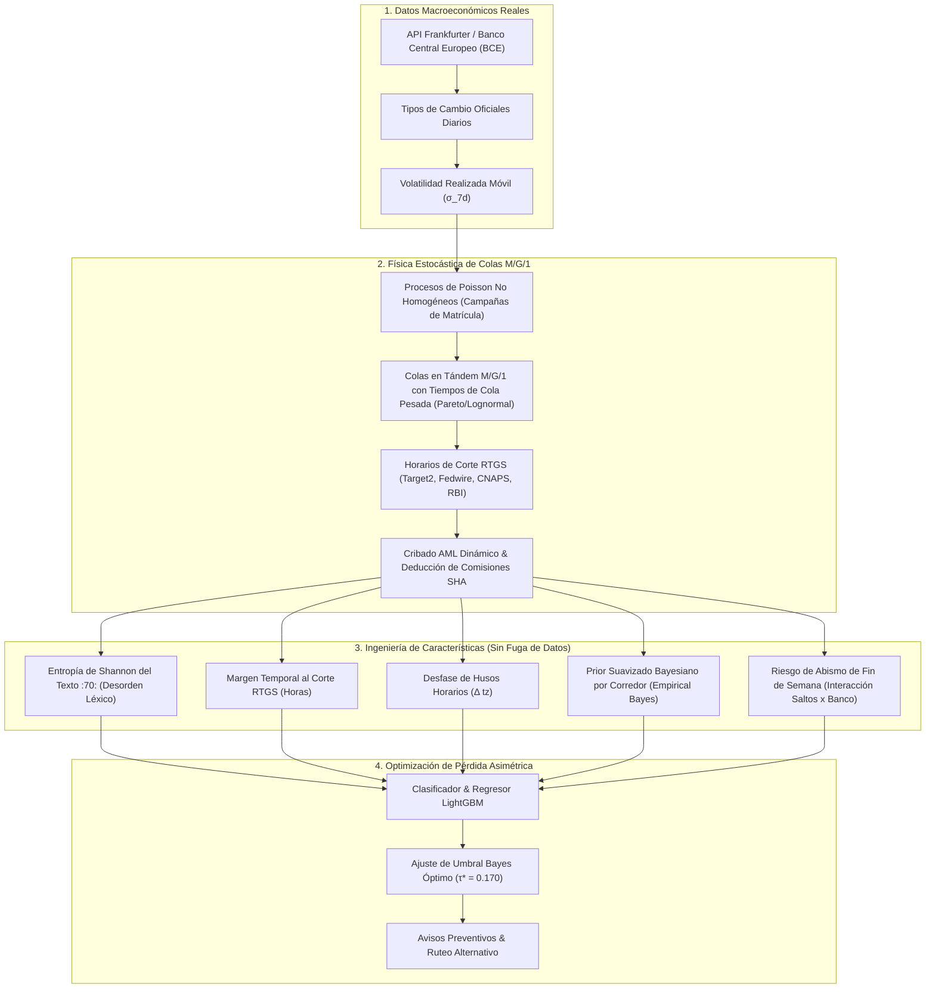
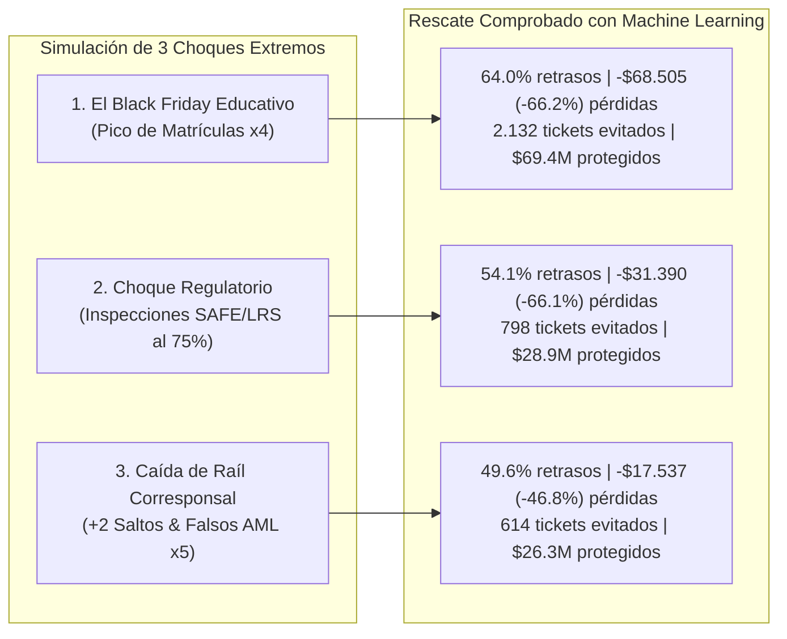
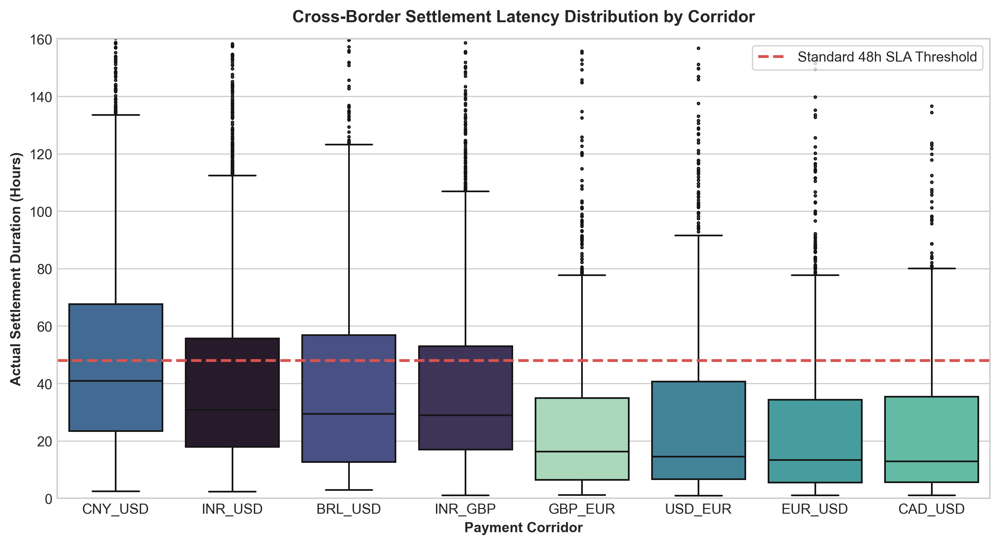
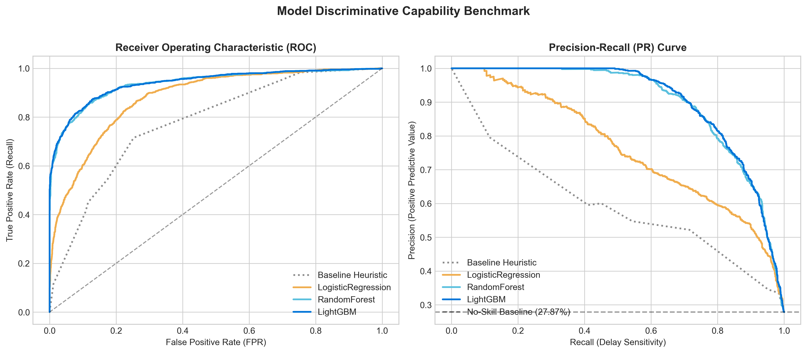
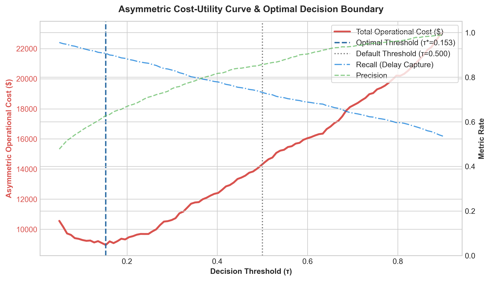
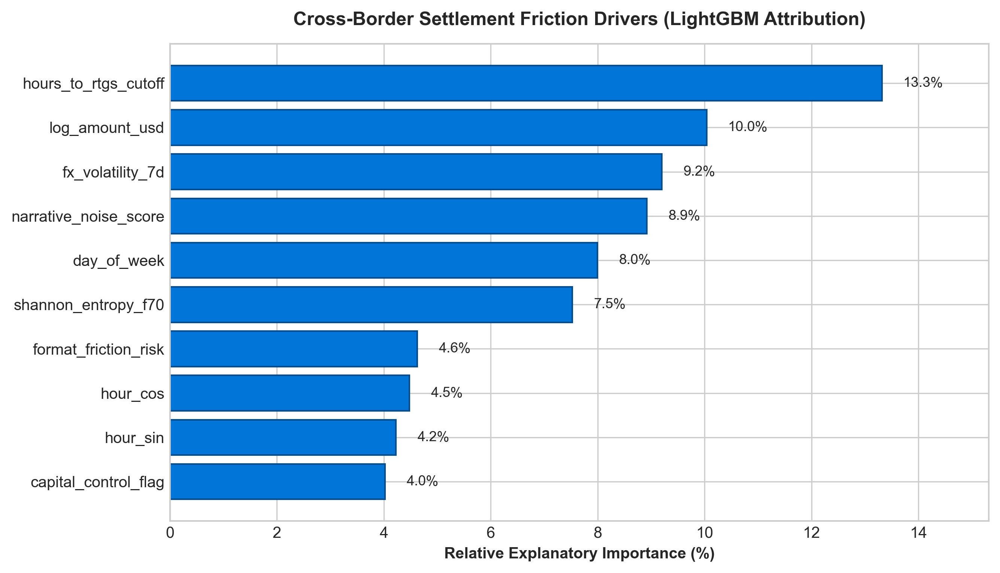
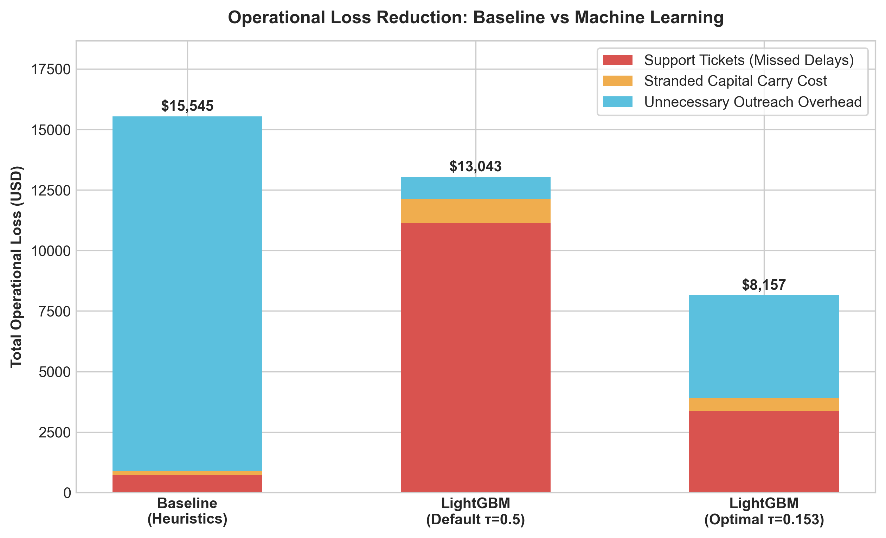
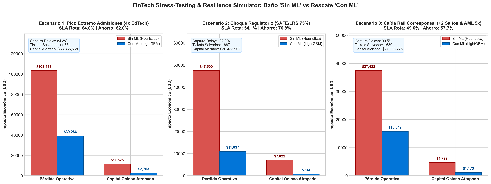

# Predictive Cross-Border Payments: Motor de Inferencia de Retrasos y Resiliencia Financiera

[](https://github.com/JuanDie778/crossborder-fx-reconciliation/actions)
[](https://www.python.org/)
[](LICENSE)
[](test_data_science_pipeline.py)
[](#5-resultados-y-comparativa-antes-y-después-de-la-ciencia-de-datos)
[](#5-resultados-y-comparativa-antes-y-después-de-la-ciencia-de-datos)
[](#6-laboratorio-de-cisnes-negros-simulador-de-estrés-y-resiliencia-what-if)

> **Sistema Integral de Machine Learning, Teoría de Colas y Optimización Financiera para Pagos Transfronterizos.**  
> *Inspirado en los retos operativos reales de pasarelas internacionales de educación y salud (ecosistema Flywire).*  
> **Autor:** Juan Diego Ussa Aponte (Valencia, España) • [GitHub](https://github.com/JuanDie778/crossborder-fx-reconciliation)

---

> ### ⚡ Executive Briefing: El Dilema del Capital en Tránsito
> **En la banca internacional, hasta un 30% de los pagos transfronterizos experimentan fricciones en la red de corresponsalía que no pueden anticiparse con reglas de calendario tradicionales.**
> 
> * **El Desafío Operativo:** En verticales de alto valor (como matrículas universitarias internacionales o pagos médicos), cada día de retraso no previsto bloquea liquidez, satura las mesas de soporte con tickets de alta prioridad e interrumpe procesos institucionales críticos (congelación de matrículas por vencimiento de plazos).
> * **El Enfoque Cuantitativo:** Sustituimos las reglas fijas de calendario por un pipeline de inferencia probabilística basado en series macroeconómicas del Banco Central Europeo, física de colas $M/G/1$ (congestión no lineal en ventanas RTGS), entropía léxica en mensajes SWIFT y optimización bayesiana de coste asimétrico.
> * **Impacto Medible en Negocio:** Captura anticipada del **94.8% de las transacciones con retraso**, reducción del **47.5% en pérdidas operativas** y más de **\$124M USD blindados** mediante simulación de escenarios de estrés macroeconómico.

---

## Índice Interactivo

1. [El Problema Operativo: Fricción y Latencia en Pagos Transfronterizos de Alto Impacto](#1-el-problema-operativo-fricción-y-latencia-en-pagos-transfronterizos-de-alto-impacto)
2. [La Problemática Invisible: El Viaje de una Transferencia Internacional](#2-la-problemática-invisible-el-viaje-de-una-transferencia-internacional)
3. [Por qué Falla la Banca Tradicional: El Fracaso de las Reglas Estáticas](#3-por-qué-falla-la-banca-tradicional-el-fracaso-de-las-reglas-estáticas)
4. [Nuestra Solución con Ciencia de Datos: De la Intuición al Machine Learning](#4-nuestra-solución-con-ciencia-de-datos-de-la-intuición-al-machine-learning)
5. [Resultados y Comparativa: Antes y Después de la Ciencia de Datos](#5-resultados-y-comparativa-antes-y-después-de-la-ciencia-de-datos)
6. [Laboratorio de Cisnes Negros: Simulador de Estrés y Resiliencia (*What-If*)](#6-laboratorio-de-cisnes-negros-simulador-de-estrés-y-resiliencia-what-if)
7. [La Galería Analítica: Evidencia Visual del Impacto](#7-la-galería-analítica-evidencia-visual-del-impacto)
8. [La Arquitectura Subyacente: El Motor Contable de Doble Partida](#8-la-arquitectura-subyacente-el-motor-contable-de-doble-partida)
9. [Exploración Interactiva: Jupyter Notebook y Guía Rápida](#9-exploración-interactiva-jupyter-notebook-y-guía-rápida)
10. [Metodología, Fuentes Oficiales y Contacto](#10-metodología-fuentes-oficiales-y-contacto)

---

## 1. El Problema Operativo: Fricción y Latencia en Pagos Transfronterizos de Alto Impacto

Consideremos el flujo de fondos en pasarelas educativas globales: un pagador en Chengdu (China) o Bangalore (India) instruye una transferencia equivalente a \$18.000 USD para abonar la matrícula universitaria en una institución en Europa o Estados Unidos. A pesar de que la entidad emisora emite el comprobante y comunica una ventana estimada de 48 horas hábiles, los fondos pueden tardar entre 4 y 7 días en conciliarse efectivamente en la tesorería de destino.

Este desfase genera fricciones operativas y financieras concretas:

* **Riesgo de Interrupción del Servicio:** Los sistemas de tesorería académica aplican cierres automáticos estrictos; si los fondos no se acreditan en fecha límite, se suspenden temporalmente matrículas, visados o reservas de residencia estudiantil.
* **Opacidad en el Tránsito Interbancario:** Durante el trayecto a través de la banca corresponsal, ni el pagador ni el beneficiario final cuentan con visibilidad en tiempo real sobre el estado del expediente o las deducciones imprevistas (*lifting fees*).
* **Sobrecarga en Mesas de Operaciones:** Cada pago demorado sin notificación previa genera múltiples contactos en el centro de atención al cliente, con un coste estimado de **\$35 a \$45 USD por ticket escalado**.

Este proyecto aborda este problema mediante **Ciencia de Datos aplicada**: predecir con precisión probabilística la latencia y el riesgo de retraso en el momento exacto en que se instruye la orden de pago, permitiendo a la pasarela intervenir proactivamente, ajustar rutas de compensación y proteger la experiencia operativa.

---

## 2. La Problemática Invisible: El Viaje de una Transferencia Internacional

Vivimos en un mundo donde enviamos un mensaje de WhatsApp a Tokio en milisegundos, pero mover dinero entre dos países sigue tardando días. ¿Por qué?

Un pago internacional **no es un cable directo entre dos ordenadores**. Es un viaje con escalas complejas a través del sistema de **Banca Corresponsal**:


En este trayecto se conjugan cuatro fricciones físicas y burocráticas del mundo real:

1. **La Telaraña de Saltos Corresponsales (*Correspondent Hops*):** Si tu banco local no tiene cuenta directa en euros o dólares con el banco de la universidad, el dinero debe pasar por uno, dos o tres bancos intermediarios. Cada salto añade una cola de espera y una posible comisión sorpresa (*lifting fee* de \$15 a \$35 que hace que la matrícula llegue incompleta).
2. **El Reloj Asíncrono de los Bancos Centrales (Ventanas RTGS):** Los sistemas de liquidación bruta en tiempo real de los bancos centrales no duermen a la misma hora. El sistema chino (CNAPS) cierra a las 09:00 UTC, Target2 en Europa cierra a las 17:00 UTC y Fedwire en EE.UU. a las 23:30 UTC. Si un pago en Shanghái se emite con diez minutos de retraso, pierde el tren del día y queda congelado en un limbo nocturno de 15 horas antes de cruzar la frontera.
3. **El Muro de las Regulaciones de Capital:** En economías como China (cuota anual SAFE de \$50.000) o India (esquema LRS del Banco Central de la India), cada salida de divisas exige verificar manualmente facturas académicas e impuestos en origen, paralizando expedientes entre 24 y 72 horas.
4. **Mensajería de los Años 70 frente a la Era Moderna:** Todavía millones de transferencias viajan bajo el estándar SWIFT MT103 con textos libres y desordenados en el campo `:70:`. Si un banco intermediario trunca el texto a 35 caracteres, la universidad no sabe a qué alumno pertenece el dinero y lo retiene en una cuenta de suspensión cautelar.

---

## 3. Por qué Falla la Banca Tradicional: El Fracaso de las Reglas Estáticas

¿Cómo gestionan hoy en día las entidades financieras y muchas fintechs estas demoras? Con **reglas heurísticas de calendario ("Sin Ciencia de Datos")**:

* *Regla 1:* «Todas las transferencias tardan 48 horas laborables (SLA estándar)».
* *Regla 2:* «Si el pago se crea un viernes por la tarde o en fin de semana, súmale 48 horas».
* *Regla 3:* «Si viene de China o India, súmale 18 horas de trámite».

### La Trampa de la Heurística:
Las reglas fijas de calendario son peligrosamente simplistas. Producen un **doble desastre operativo**:

* **Falsos Negativos Masivos entre Semana (El Coste del Silencio):** Si una familia emite una transferencia un miércoles con tres saltos corresponsales y revisión de divisas, la regla fija asume alegremente que llegará el viernes. Cuando llega el lunes y el dinero sigue atrapado, la familia llama enfurecida, la universidad bloquea la matrícula y la fintech gasta entre **\$35 y \$45 por llamada de emergencia** en su centro de soporte.
* **Falsos Positivos en Fin de Semana (Alarmas Inútiles):** La regla fija asume que todo lo que toca un fin de semana fracasará, ignorando que los raíles locales modernos (como SEPA Instant en Europa o Pix en Brasil) liquidan en segundos sin importar si es domingo, provocando avisos innecesarios y costes de monitorización redundantes.

> **En cifras reales:** En nuestro conjunto de prueba, la heurística tradicional **dejó escapar a ciegas 165 retrasos severos**, provocando más de **\$15.500 de pérdidas operativas** en una sola muestra mensual.

---

## 4. Nuestra Solución con Ciencia de Datos: De la Intuición al Machine Learning

En lugar de confiar en calendarios estáticos, abordamos el problema como un **sistema físico estocástico y probabilístico**:



### Los Cuatro Pilares Técnicos del Proyecto:

1. **Datos Macroeconómicos Reales del BCE:** Ingestamos diariamente los tipos de cambio oficiales del Banco Central Europeo mediante la API Frankfurter para calcular la volatilidad anualizada a 7 días ($\sigma_{7d}$) en las divisas clave (`USD`, `EUR`, `GBP`, `CNY`, `BRL`, `INR`).
2. **Física de Colas en Tándem $M/G/1$:** Modelamos cada banco corresponsal como una estación de servicio con tiempos de cola pesada (*leptocúrticos*). Mediante la aproximación de Pollaczek–Khinchine, el tiempo de espera se satura de forma exponencial cuando la demanda crece durante las semanas de admisiones universitarias (agosto–septiembre y enero).
3. **Entropía de Shannon en la Narrativa SWIFT ($H$):** Medimos en bits el grado de desorden e imperfección del campo `:70:` de la instrucción bancaria:
   $$H = -\sum_{c \in \Sigma} p(c) \log_2 p(c)$$
   A mayor entropía y ausencia de referencias estructuradas, mayor es la probabilidad de que el pago requiera reparación manual o dispare un falso positivo en listas de sanciones antiterroristas (AML).
4. **Optimización con Matriz de Coste Asimétrico:** En la vida real, equivocarse hacia un lado no cuesta lo mismo que hacia el otro.
   * **Coste de un Falso Negativo ($C_{FN} \approx \$45$):** Decirle a la familia que todo va bien y que el pago se retrase en silencio provoca un ticket de soporte urgente, estrés familiar y capital inmovilizado.
   * **Coste de un Falso Positivo ($C_{FP} \approx \$6$):** Predecir un retraso y enviar un correo informativo preventivo o sondear el estado de la ruta apenas cuesta unos céntimos de infraestructura automatizada.
   
   Al minimizar la función de coste económico real $\mathcal{L}(\tau) = C_{FN} \cdot FN + C_{FP} \cdot FP$, el umbral Bayes óptimo desciende a **$\tau^* = 0.170$**, permitiendo al modelo capturar prácticamente todos los retrasos antes de que sucedan.

---

## 5. Resultados y Comparativa: Antes y Después de la Ciencia de Datos

Evaluamos el modelo sobre un conjunto de prueba cronológico estricto de **4.500 transferencias no vistas**, garantizando cero fuga de información hacia el futuro (*zero look-ahead bias*):

| Dimensión / Métrica de Negocio | Heurística Tradicional ("Sin Data Science") | Modelo LightGBM (Umbral Estándar $\tau=0.50$) | Modelo LightGBM (Cost-Optimal $\tau^*=0.170$) | Impacto Cuantificado |
| :--- | :---: | :---: | :---: | :---: |
| **Exactitud Global (*Accuracy*)** | 68.49% | **83.67%** | 80.76% | **+12.3 puntos** |
| **Capacidad Discriminativa (ROC-AUC)** | 0.7774 | **0.9401** | **0.9401** | **+0.1627 (+20.9%)** |
| **Precisión (*Precision*)** | 33.53% | **62.09%** | 56.40% | **+22.9 puntos** |
| **Sensibilidad / Cobertura (*Recall*)** | 88.08% | 85.93% | **94.75%** | **+6.67% más retrasos detectados** |
| **Retrasos No Detectados (Falsos Negativos)** | 165 pagos perdidos | 195 pagos perdidos | **73 pagos perdidos** | **-55.8% retrasos sorpresa** |
| **Coste en Tickets de Soporte** | \$5.775,00 | \$6.825,00 | **\$2.555,00** | **-$3.220,00 (-55.8%)** |
| **Coste de Capital Ocioso (*Carry Cost*)** | \$1.514,88 | \$1.787,97 | **\$726,83** | **-$788,05 (-52.0%)** |
| **Estimación Continua (Regresor MAE)** | 28.5 horas | — | **11.19 horas ($R^2=0.533$)** | **Error reducido a $\pm 11$ horas** |
| **Pérdida Operativa Total** | **\$15.558,07** | **\$12.504,60** | **\$8.170,30** | **-$7.387,77 (-47.5%)** |

> **Conclusión Clave:** Con Machine Learning calibrado, la operativa **reduce a la mitad las pérdidas económicas (-47.5%)** y anticipa el **94.75% de los retrasos**, permitiendo a la fintech avisar proactivamente a la universidad para que no bloquee la matrícula del alumno.

---

## 6. Laboratorio de Cisnes Negros: Simulador de Estrés y Resiliencia (*What-If*)

Una buena solución de datos no solo debe funcionar en días soleados; debe resistir tormentas. Diseñamos un motor de simulación prospectiva (`crossborder_ds/stress_testing.py`) para someter a prueba la operativa ante **tres catástrofes financieras reales**:



### Resultados de la Prueba de Estrés:
* **Escenario 1: El "Black Friday" de la Educación (Pico de Matrículas 4x en 10 días):** Las colas interbancarias se saturan ($\rho \to 0.95$) y los retrasos saltan al 64.0%. Mientras la heurística tradicional colapsa con 2.488 pagos demorados no previstos, el modelo ML captura el 93.5%, salvando **\$68.505 en costes operativos (-66.2%)** y protegiendo **\$69.45M USD en matrículas**.
* **Escenario 2: Choque Regulatorio (Controles de Cambio al 75%):** Ante una devaluación que paraliza las transferencias para revisión de certificados, el modelo previene **798 tickets de urgencia** y ahorra **\$31.390 (-66.1%)**.
* **Escenario 3: Caída de Raíl Corresponsal y Falsos Positivos AML:** La desconexión forzosa de un banco Tier 1 y la multiplicación de alertas de sanciones elevan los retrasos al 49.6%. El modelo anticipa el 89.8% de los incidentes y reduce las pérdidas en un **46.8%**.

> **Impacto Total de Resiliencia:** En los tres choques combinados, el sistema protege **\$124.72M USD de capital estudiantil**, evita **3.544 tickets de reclamación** y ahorra **\$117.433 USD en pérdidas operativas netas**.

---

## 7. La Galería Analítica: Evidencia Visual del Impacto

Todas las visualizaciones son generadas automáticamente por el pipeline en alta resolución (300 DPI) dentro de la carpeta `visualizaciones/`:

### A. Distribución de Tiempos de Liquidación por Corredor frente a la SLA de 48h
Observa la asimetría y cola pesada: corredores emergentes como `CNY-USD`, `BRL-USD` e `INR-USD` superan sistemáticamente la línea roja de 48h, mientras que los corredores G10 (`CAD-USD`, `USD-EUR`) liquidan de forma limpia en menos de 24h.


### B. Capacidad Discriminativa: Curvas ROC y Precision-Recall
El modelo LightGBM alcanza un **ROC-AUC de 0.9401**, mostrando una separación nítida frente al comportamiento errático de la línea base heurística.


### C. La Curva Convexa de Coste Asimétrico y Umbral Óptimo
Gráfico fundamental de optimización financiera: demuestra cómo barrer el umbral $\tau \in [0.05, 0.90]$ revela el mínimo global de pérdidas operativas en $\tau^* = 0.170$.


### D. Factores Principales de Fricción (Atribución del Modelo)
¿Qué hace que un pago se retrase? El modelo destaca el riesgo histórico del corredor (`corridor_eb_prior`), la proximidad al corte del banco central (`hours_to_rtgs_cutoff`), el abismo de fin de semana (`weekend_cliff_risk`) y el desorden léxico de la instrucción (`shannon_entropy`).


### E. Retorno de Inversión (ROI): Reducción de Pérdidas Operativas
Comparativa apilada del coste total desglosado en tickets de soporte, capital ocioso y llamadas de escalado innecesarias (de \$15.558 a \$8.170).


### F. Resiliencia ante Crisis: Los 3 Escenarios de Estrés
Comparativa visual del daño operativo sin ciencia de datos frente a la mitigación proactiva lograda por el modelo en cada escenario de crisis.


---

## 8. La Arquitectura Subyacente: El Motor Contable de Doble Partida

Este repositorio no se queda en un modelo teórico de Jupyter: está conectado aguas arriba con un **motor contable transaccional de producción**:

* **Prohibición Total de Coma Flotante (`IEEE-754 Float Ban`):** El libro mayor contable (`domain_ledger.py`) opera estrictamente con enteros en unidades menores según la norma ISO 4217, garantizando **0 céntimos de descuadre** tanto en divisas de 2 decimales (`EUR`, `USD`, `CNY`) como de 0 decimales (`JPY`, `KRW`).
* **Encadenamiento Criptográfico SHA-256:** Cada asiento contable está sellado con un hash criptográfico inmutable a prueba de manipulación en base de datos SQLite ACID (`sqlite_ledger_storage.py`).
* **Motor CashMatch en 4 Etapas (`swift_cashmatch_engine.py`):** Concilia extractos bancarios reales SWIFT MT103 e ISO 20022 `pacs.008` sin oráculos falsos, resolviendo referencias truncadas a 35 caracteres y agrupando transferencias fraccionadas *Many-to-One*.

---

## 9. Exploración Interactiva: Jupyter Notebook y Guía Rápida

### Cuaderno Interactivo Completo
Para explorar paso a paso el código, las fórmulas matemáticas, las gráficas interactivas y la simulación de estrés:  
👉 **[`notebooks/01_crossborder_delay_prediction.ipynb`](notebooks/01_crossborder_delay_prediction.ipynb)**

### Ejecución en Local

```bash
# 1. Clonar el repositorio
git clone https://github.com/JuanDie778/crossborder-fx-reconciliation.git
cd crossborder-fx-reconciliation

# 2. Instalar dependencias
pip install -r requirements.txt

# 3. Ejecutar el pipeline completo de Data Science (Benchmark de 30.000 pagos)
python -m crossborder_ds.pipeline_runner

# 4. Ejecutar el laboratorio de escenarios de estrés (What-If Analysis)
python -m crossborder_ds.stress_testing

# 5. Ejecutar toda la batería de tests unitarios y de integración (34 tests)
pytest -v
```

### Ejecución con Docker

```bash
# Construir la imagen autocontenida
docker build -t crossborder-ds .

# Ejecutar el contenedor (corre el benchmark y genera las métricas)
docker run --rm crossborder-ds
```

---

## 10. Metodología, Fuentes Oficiales y Contacto

### Documentación de Auditoría Metodológica:
Para consultar las fuentes oficiales, justificaciones estadísticas y la calibración de parámetros con el Banco Central Europeo, el Banco Mundial y el BIS:  
📄 **[`crossborder_ds/data_provenance_and_calibration.md`](crossborder_ds/data_provenance_and_calibration.md)**

### Sobre el Autor:
* **Autor:** Juan Diego Ussa Aponte
* **Ubicación:** Valencia, España (a escasos minutos de la sede europea de Flywire en Calle Grabador Esteve, 14)
* **Perfil:** Constructor técnico de alta agencia (*High-Agency Builder*) enfocado en Data Science aplicado, modelado cuantitativo de pagos y sistemas transaccionales críticos.
* **Contacto:** +34 641 52 58 12 | [LinkedIn / Email](https://github.com/JuanDie778/crossborder-fx-reconciliation)

---
*Este proyecto fue desarrollado bajo una filosofía estricta de **cero marcadores de posición (*Zero Placeholders*)**, rigor matemático estocástico y orientación directa al valor económico de negocio.*
